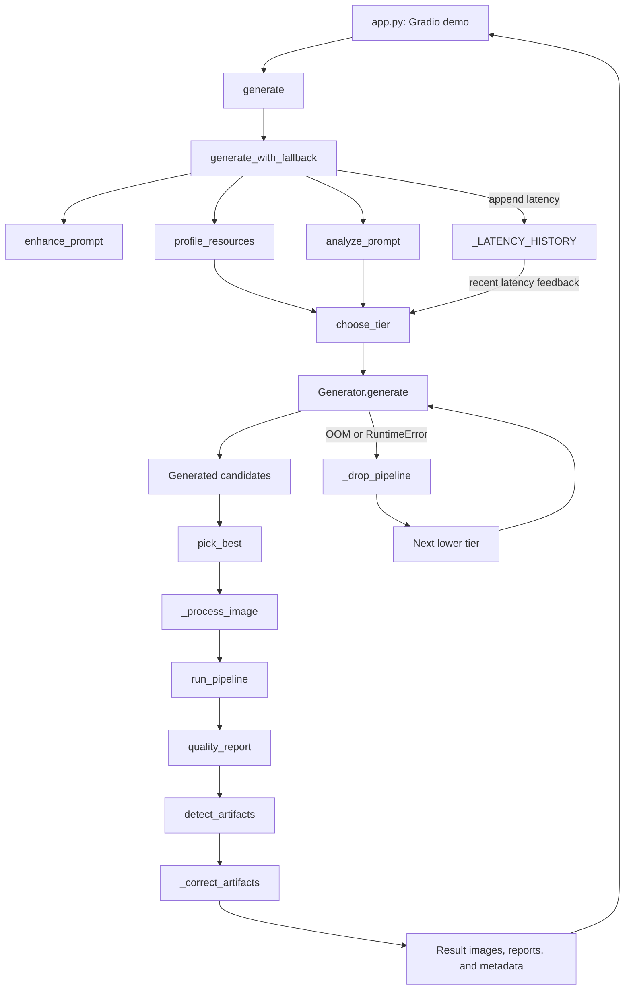
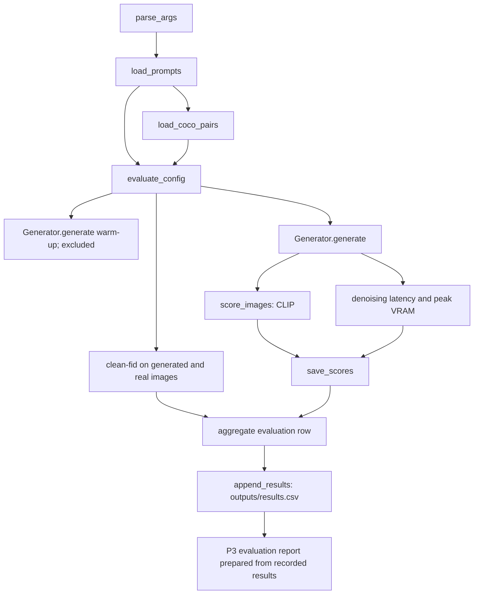

# Flicker Architecture

## Runtime flow

## Offline evaluation flow

The evaluator computes the aggregate result data and writes `outputs/results.csv`. The Markdown report is a separate deliverable prepared from those recorded results.

## Component map

| Component | File | Responsibility |
|---|---|---|
| Gradio interface | [app.py](../app.py) | Collect prompts/options, invoke generation, display images and reports |
| Adaptive orchestration | [src/adaptive.py](../src/adaptive.py) | Resource profile, tier choice, fallback, candidates, reranking, post-processing |
| Model generation | [src/generate.py](../src/generate.py) | Load Diffusers models and generate images |
| Prompt analysis | [src/prompt_analyzer.py](../src/prompt_analyzer.py) | Extract prompt concepts and complexity |
| Prompt enhancement | [src/prompt_enhancer.py](../src/prompt_enhancer.py) | Remove instruction lead-ins and expand visual concepts |
| Candidate scoring | [src/rerank.py](../src/rerank.py) | Score candidate images against text with CLIP |
| CV and quality | [src/postprocess.py](../src/postprocess.py) | Classical image operations, quality reports, artifact detection |
| Dataset loading | [src/dataset.py](../src/dataset.py) | Sample COCO validation image-caption pairs |
| Offline evaluation | [src/evaluate.py](../src/evaluate.py) | Generate evaluation images, compute metrics, write aggregate results |
| Visual layer | [src/ui_theme.py](../src/ui_theme.py) | Hero, butterfly background, optional mosaic, CSS, and Gradio theme |
| Package marker | [src/__init__.py](../src/__init__.py) | Declare the `src` package |
