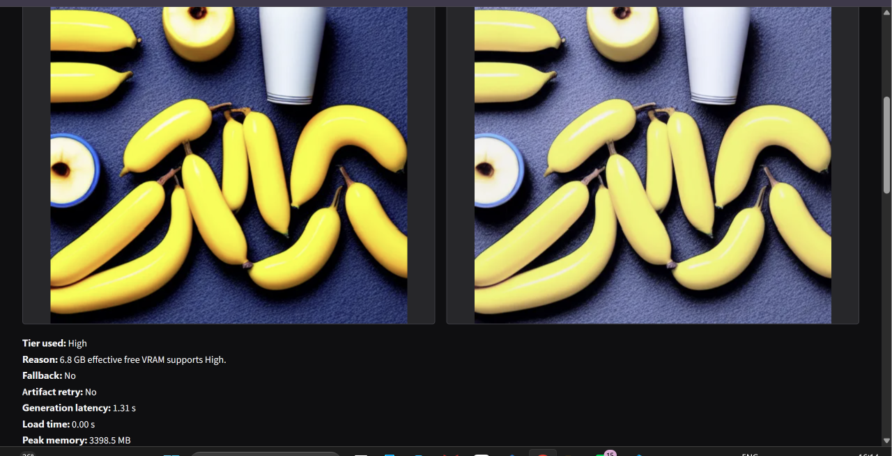
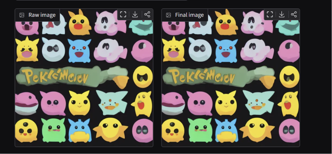
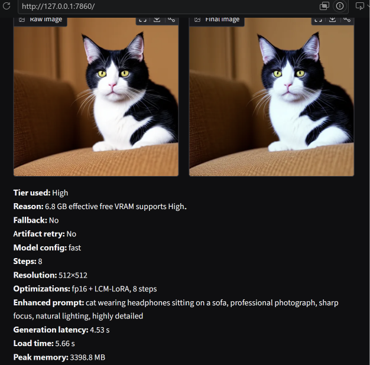
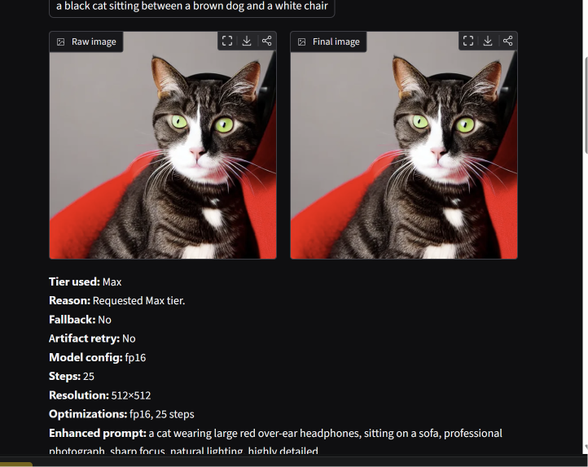
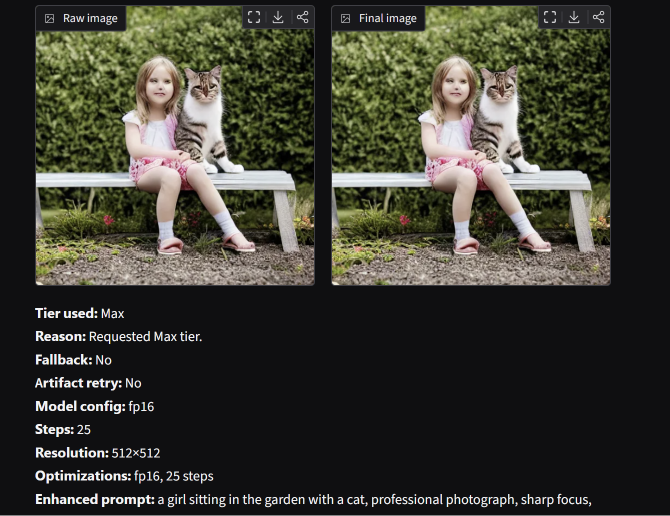
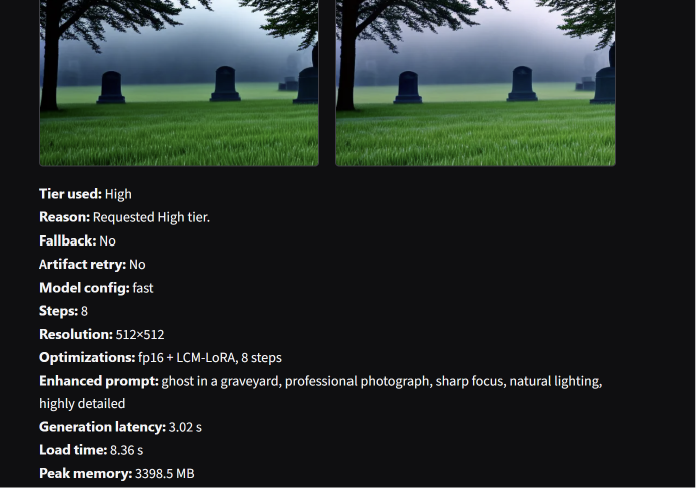
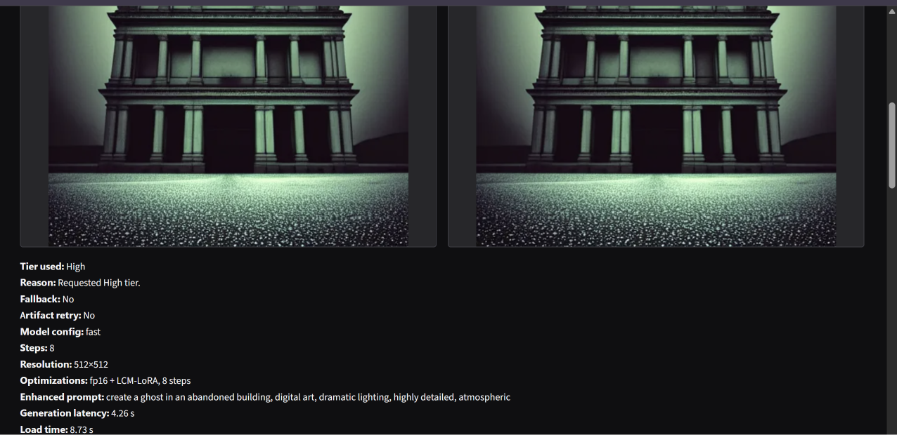

# Flicker – Failure-case analysis (Team Chaos Theory)

## 1. Counting and colour binding

| Field | Analysis |
|---|---|
| Prompt | “three blue cups to the left of two yellow bananas” |
| Tier / config | High tier (fast: fp16 + LCM-LoRA) |
| Expected | 3 blue cups and 2 bananas |
| Actual | About 10 bananas, no blue cups, and one white cup |
| Root cause | SD v1.5's CLIP text encoder binds counts and colours to objects weakly. |
| Mitigation tried | CLIP best-of-N reranking and Max tier |
| Outcome | Known limitation |

## 2. Text rendering and IP

| Field | Analysis |
|---|---|
| Prompt | A prompt naming a cartoon franchise |
| Tier / config | Not specified |
| Expected | Readable lettering and a depiction that does not imitate trademarked characters |
| Actual | Garbled lettering (“Pekémciov”) and imitations of trademarked characters |
| Root cause | The text encoder sees word tokens, not letters, so the model never learned spelling; it reproduces styles from training data. |
| Mitigation tried | Documented in Ethics; future work is a prompt filter for brand/character names. |
| Outcome | Known limitation |

## 3. Rare concept composition

| Field | Analysis |
|---|---|
| Prompt | “a cat wearing large red over-ear headphones, sitting on a sofa” |
| Tier / config | High (fast, 4–8 steps, guidance 1.0–1.8); Max (fp16, 25 steps, guidance 7.5) |
| Expected | A cat wearing large red over-ear headphones while sitting on a sofa |
| Actual | High omitted the headphones. Max also omitted them, drew only a partial dark band, and moved “red” onto the sofa (attribute leakage). |
| Root cause | Rare animal-plus-accessory pairs in training data and weak attribute binding; low LCM guidance favours the main subject. |
| Mitigation tried | Concrete wording, prompt enhancer, 3-candidate CLIP reranking, and Max tier |
| Outcome | Not fixed; documented |

## 4. Small-face distortion

| Field | Analysis |
|---|---|
| Prompt | “a girl sitting in the garden with a cat” |
| Tier / config | Max tier |
| Expected | A coherent scene with recognizable faces |
| Actual | Faces are distorted because a small face gets too few pixels at 512×512. |
| Root cause | A small face receives too few pixels at 512×512. |
| Mitigation tried | Close-up framing (“close-up portrait of…”); a face restoration model is future work. |
| Outcome | Close-up framing is a workaround |

## 5. Abstract subject omitted

| Field | Analysis |
|---|---|
| Prompt | “ghost in a graveyard”; “create a ghost in an abandoned building” |
| Tier / config | High tier |
| Expected | A visible ghost in each scene |
| Actual | The scenes were drawn, but no ghost appeared. |
| Root cause | “Ghost” has no consistent visual form. The enhancer initially added “professional photograph, natural lighting,” pushing toward realistic empty scenes; “create” is an instruction word the model ignores. |
| Mitigation tried | Mood-aware enhancer (fantasy → digital art terms), stripping instruction words, concept expansion (ghost → translucent glowing figure), and concept-grounded reranking |
| Outcome | Partially improved |

## 6. Configuration findings from ablations

| Field | Analysis |
|---|---|
| Prompt | No image; configuration ablations |
| Tier / config | Fast / LCM |
| Expected | More steps or higher guidance would improve results enough to justify added compute. |
| Actual | 8 LCM steps scored worse than 4 (CLIP 30.65 vs 31.56, FID 144.9 vs 141.9). Guidance 1.8 was worse and 35% slower than 1.0 (CLIP 31.42 vs 31.56, latency 0.71 vs 0.53 s). |
| Root cause | The tested 4-step, guidance 1.0 configuration outperformed the tested alternatives on these measures. |
| Mitigation tried | High uses 4 steps and guidance 1.0. |
| Outcome | Configuration action taken |

## Summary

| Case | Root cause | Mitigation | Status |
|---|---|---|---|
| Counting and colour binding | Weak count and colour binding in the SD v1.5 CLIP text encoder | CLIP best-of-N reranking; Max tier | Known limitation |
| Text rendering and IP | Token-based text representation and reproduction of styles from training data | Ethics documentation; brand/character prompt filter is future work | Known limitation |
| Rare concept composition | Rare animal-accessory combinations and weak attribute binding | Concrete wording, prompt enhancer, 3-candidate reranking, Max tier | Not fixed; documented |
| Small-face distortion | Too few pixels for small faces at 512×512 | Close-up framing; face restoration is future work | Workaround |
| Abstract subject omitted | Inconsistent visual form and enhancement/instruction phrasing that steered away from the concept | Fantasy-aware terms, instruction stripping, concept expansion, concept-grounded reranking | Partially improved |
| Configuration findings | More LCM steps and higher guidance underperformed in the measured ablations | High uses 4 steps, guidance 1.0 | Action taken |

## Lessons

Most failures come from SD v1.5's text encoder; larger models (SDXL, SD3) handle composition better but exceed our mobile memory budget, which is the trade-off this project studies.
